<div align="center">


# 墨脉

### AI 小说创作桌面应用

<p>
  面向需要长期维护项目设定、角色关系、剧情结构与章节正文的创作者
</p>

<p>
  📘 <a href="docs/user-guide.md"><strong>墨脉使用教程图文版</strong></a>
</p>

<p>
  
  
  
  
  
  
  
</p>

<p>
  <a href="#-功能概览">功能概览</a> ·
  <a href="#-截图">截图</a> ·
  <a href="#-快速开始">快速开始</a> ·
  <a href="#-技术栈">技术栈</a> ·
  <a href="#-内置-skill-包">Skill 包</a> ·
  <a href="#-鸣谢">鸣谢</a>
</p>

</div>

---

## ✨ 项目简介

墨脉是一套围绕小说项目组织、章节写作与 AI 协作搭建的桌面工作台，支持从原创构思、参考作品拆解、世界观与大纲规划，到章节创作、审阅和导出。

本文按当前仓库代码说明功能；版本号取自 [package.json](./package.json)，具体安装包所含功能以对应构建版本为准。版本记录见 [CHANGELOG.md](./CHANGELOG.md)。

<table>
  <tr>
    <td width="50%" valign="top">
      <h4>🏠 本地优先</h4>
      <p>项目数据保存在本机 SQLite，手动编辑与资料管理可离线使用；调用远程 AI 时会发送本次任务所需的上下文。</p>
    </td>
    <td width="50%" valign="top">
      <h4>📦 项目隔离</h4>
      <p>每个项目独立维护设定、章节、知识库与 AI 运行记录，互不干扰。</p>
    </td>
  </tr>
  <tr>
    <td width="50%" valign="top">
      <h4>📖 章节导向</h4>
      <p>大纲、灵感、知识和 AI 能力最终都围绕章节创作落地。</p>
    </td>
    <td width="50%" valign="top">
      <h4>🧩 Skill 驱动</h4>
      <p>AI 调用可按任务自动匹配内置 / 项目级 Skill 包，并支持 Agent Loop 调度。</p>
    </td>
  </tr>
  <tr>
    <td colspan="2" valign="top">
      <h4>🌐 多厂商接入</h4>
      <p>支持 Codex CLI、OpenAI 兼容接口（DeepSeek、通义千问、智谱、Kimi、SiliconFlow、Ollama 等）和 Anthropic 协议（官方及中转站）。</p>
    </td>
  </tr>
</table>

## 🚀 功能概览

<details open>
<summary><b>📂 项目与资料</b></summary>

- **项目中心**：创建、查看、编辑、删除小说项目
- **新建项目向导**：填写题材、篇幅、简介，可调用 AI 生成首批设定与大纲
- **新书对话构思**：通过 AI 多轮讨论整理创意，生成简介并回填创建表单
- **创作记忆面板**：按分卷维护计划、进度、伏笔和素材，支持参考作品拆解
- **自动派生创作记忆账本**：从章节、大纲、人物、伏笔和项目约束生成统一小结，各模型共用同一份项目进度
- **知识中心**：沉淀项目事实、创作记忆、参考资料与风格分析结果
- **分维度深度拆书**：开篇读取黄金章节，主线覆盖全书前中后段，人物与世界观按关键词命中章节取样，并支持缺失维度续作
- **拆书转原创立项**：先在用户原创方向内生成 4 条因果机制不同的故事路线，手动选定后再生成可审阅的分卷与章节骨架
- **多本参考分工**：支持 1 本主参考与最多 2 本辅助参考，每本分别指定用途；结构参考与文风指纹独立设置，默认不绑定文风
- **创建草稿自动恢复**：本机保存参考分工、表单、路线、骨架与未采纳修改，从同一作品和主参考重新打开即可继续
- **创建前修改骨架**：支持手动修改卷目标、剧情节点和章节建议，也可与 AI 对话生成修改方案，审阅后应用
- **跳过骨架直接创建**：可复制当前小说的世界观文字，创建带空白起始卷和首章占位的新项目
- **项目归档与工作区备份**：支持项目归档导入导出，以及包含数据库、参考原文、封面和导入 Skill 的完整本地备份与恢复
- **技能系统**：支持启用内置 Skill，也支持为单项目导入额外 Skill 包

</details>

<details open>
<summary><b>🌍 世界观与结构</b></summary>

- **世界观 / 角色 / 组织 / 关系管理**：维护小说基础设定资产；世界观批量生成会将英文分类统一归一为中文分类
- **关系图谱**：可视化角色关系与组织关联（Cytoscape）
- **剧情大纲**：双栏交错时间线布局，按分卷组织剧情节点，支持拖拽排序、单条或批量移动到分卷、批量删除与 AI 扩写；移动可联动关联章节、预览数量并撤销一次
- **剧情线索**：辅助维护伏笔、悬念和回收计划

</details>

<details open>
<summary><b>✍️ 章节创作</b></summary>

- **三栏布局**：目录树 + 正文编辑器 + AI 侧边栏
- **按大纲新建章节**：新建章节时先选择大纲节点，自动带入标题、摘要、字数目标并建立绑定
- **拆书骨架章节规划**：一个剧情节点可展开为多章建议，审阅骨架后批量创建并保持与原大纲节点绑定
- **富文本编辑**：基于 TipTap，支持搜索替换、格式化、选区动作
- **自动保存与历史版本**：编辑后自动落盘，支持手动快照与回滚
- **阅读模式 / 专注模式**：以更接近成稿阅读的方式检查节奏
- **字数目标**：按章节设置目标字数并跟踪完成度
- **导出**：章节正文可导出为 `.txt` / `.docx`，工作区可导出 JSON 快照

</details>

<details open>
<summary><b>🤖 AI 辅助</b></summary>

- 章节润色、续写、改写、节奏调整
- 章节摘要生成、伏笔识别、后续剧情链生成
- **章节初稿流程**：写作备忘 → 初稿 → 审计 → 自动修复 / 去 AI 味 / 写作日志，可按步骤配置
- AI 初稿流式生成、场景规划、章节分析
- **推理内容隔离**：兼容 MiniMax、DeepSeek、通义、Kimi、GLM 等模型的 reasoning 字段，并避免思考标记写入正文
- **接口错误详情**：优先展示中转站返回的 `error` / `message` / `responseBody` 和 HTTP 状态码
- 灵感发散包生成、参考作品深度拆解
- **全局助手 v2**：检索当前项目各类资料与公共拆书库，支持设定修改、审计沉淀和暂存变更审阅
- **Agent Loop 模式**：让模型按 Skill 索引与工具注册表循环思考，v2 可按对话自动匹配 Skills
- **任务进度面板**：统一查看正在运行与历史 AI 任务
- **可恢复任务状态**：应用重启后保留中断记录；拆书、状态补录等有检查点的任务从未完成步骤继续
- **Skill 使用策略**：支持自动匹配、仅使用指定 Skill、不使用 Skill；自动模式可按需加载其他已启用技能，固定模式按指定范围执行

</details>

<details open>
<summary><b>🎨 封面工作台</b></summary>

- 面向平台（番茄、起点、晋江、知乎盐言、七猫、刺猬猫等）生成封面 Prompt
- 支持图像 API 或本机 Codex CLI 模式，生成后可直接设为作品封面
- 生成记录保留在当前会话中用于对比；设为作品封面的图片保存到本地

</details>

<details open>
<summary><b>🎮 游戏数值与网游写作</b></summary>

- **作品级开关**：按需启用游戏数值档案，为人物配置初始等级、属性、背包、装备、称号和已学技能
- **属性增长**：默认每级获得 5 个属性点，分配到力量、敏捷、智力或体质，自动换算生命、魔法、攻击、法强、速度、闪避与暴击
- **可配置规则**：可设置每级点数与派生系数；产生章节记录后锁定派生公式和对应人物初始档案，防止重算历史
- **装备与技能目录**：高级工具支持按风格、等级、槽位与品质生成原创装备及技能，预览后加入作品目录
- **章节数值账本**：记录升级、加点、换装、技能释放、受伤、恢复与物品消耗，沿章节时间线回放；AI 产生的变化先暂存供作者确认
- **网游数值战斗写作 Skill**：结合指定拆书的战斗节奏与已确认数值，呈现人物和怪物的属性对照、资源消耗、战术变化与战后结算

派生系数、属性小数精度与战斗公式按章节保存规则版本，较早章节继续使用旧规则。可配置命中上下限、闪避及暴击上限、减伤与速度行动频率，在双方试算中填写判定点数并暂存伤害；战斗规则默认关闭。怪物需要有对应人物卡及数值档案。数值面板支持展开。

助手支持“检查全部人物”自动分批审查，并显示本轮工具实际返回的全文、摘要和未完整读取范围。

</details>

## 📸 截图

以下为 **v1.22.44 当前代码构建的真实界面**，使用独立的原创演示数据。点击图片查看大图；完整操作步骤见 [墨脉使用教程图文版](docs/user-guide.md)。

<table>
  <tr>
    <td width="50%" align="center">
      <a href="docs/assets/tutorial/01-projects.png">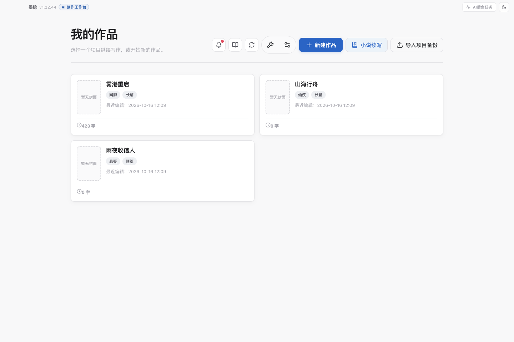</a>
      <br /><sub><b>项目中心</b> · 管理作品与进入高级工具</sub>
    </td>
    <td width="50%" align="center">
      <a href="docs/assets/tutorial/02-overview.png">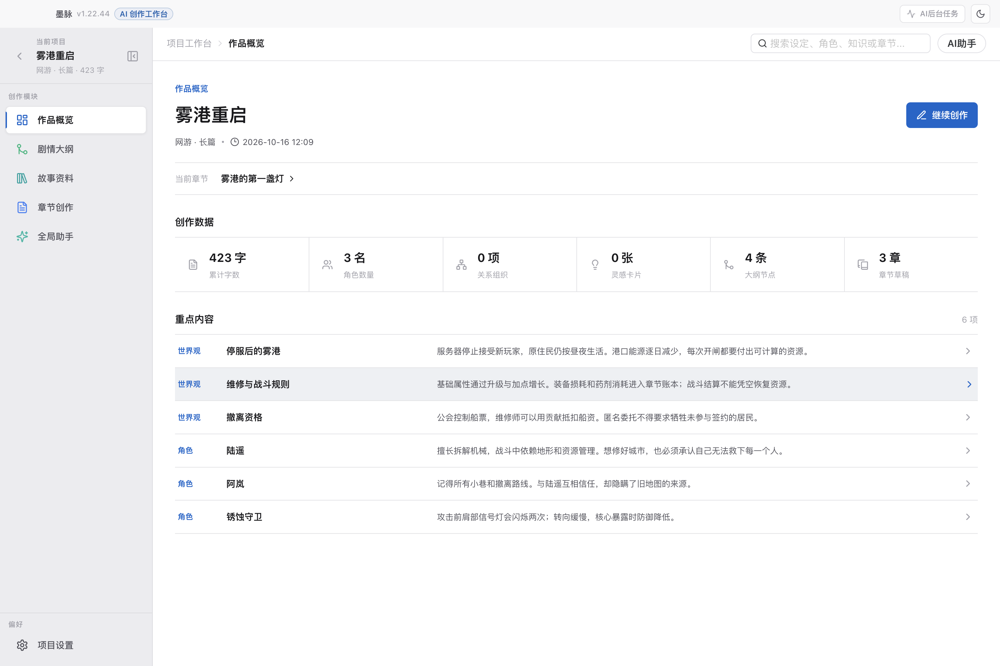</a>
      <br /><sub><b>作品概览</b> · 检查项目简介与创作进度</sub>
    </td>
  </tr>
  <tr>
    <td width="50%" align="center">
      <a href="docs/assets/tutorial/06-references.png">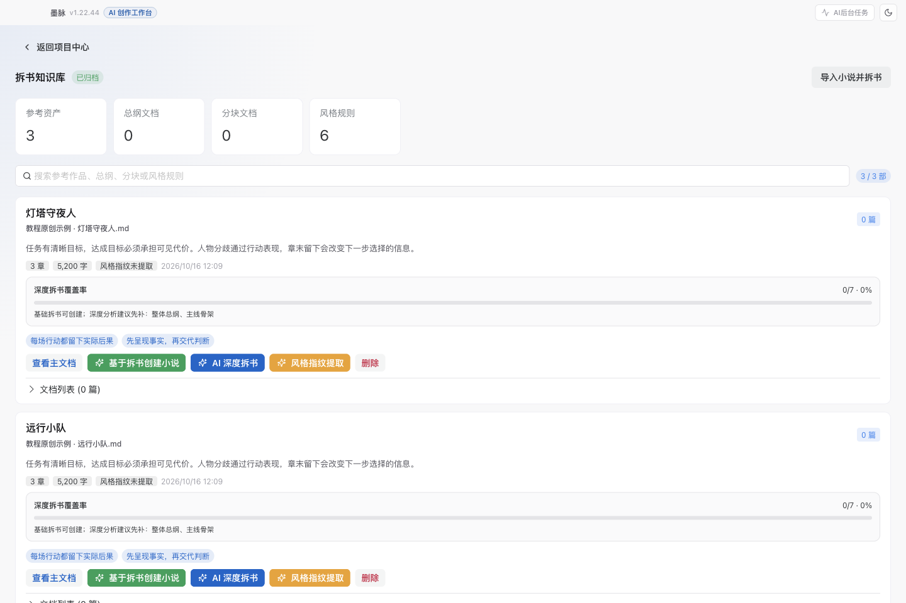</a>
      <br /><sub><b>拆书知识库</b> · 整理参考作品与分析维度</sub>
    </td>
    <td width="50%" align="center">
      <a href="docs/assets/tutorial/09-reference-create.png">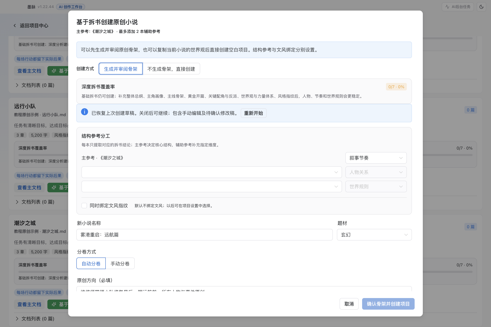</a>
      <br /><sub><b>多本参考创建</b> · 明确参考分工，单独选择文风绑定</sub>
    </td>
  </tr>
  <tr>
    <td width="50%" align="center">
      <a href="docs/assets/tutorial/03-outline.png">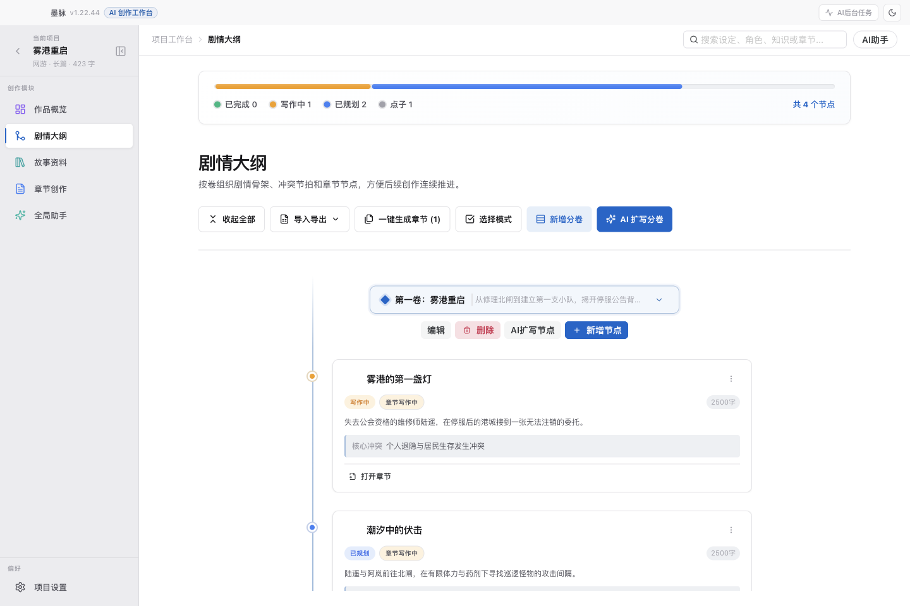</a>
      <br /><sub><b>剧情大纲</b> · 分卷组织节点与关联章节</sub>
    </td>
    <td width="50%" align="center">
      <a href="docs/assets/tutorial/11-outline-move.png">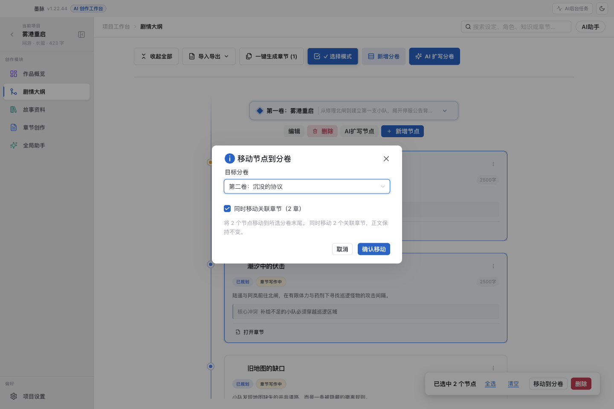</a>
      <br /><sub><b>批量移动大纲</b> · 选中节点后移到目标分卷</sub>
    </td>
  </tr>
  <tr>
    <td width="50%" align="center">
      <a href="docs/assets/tutorial/04-story-data.png">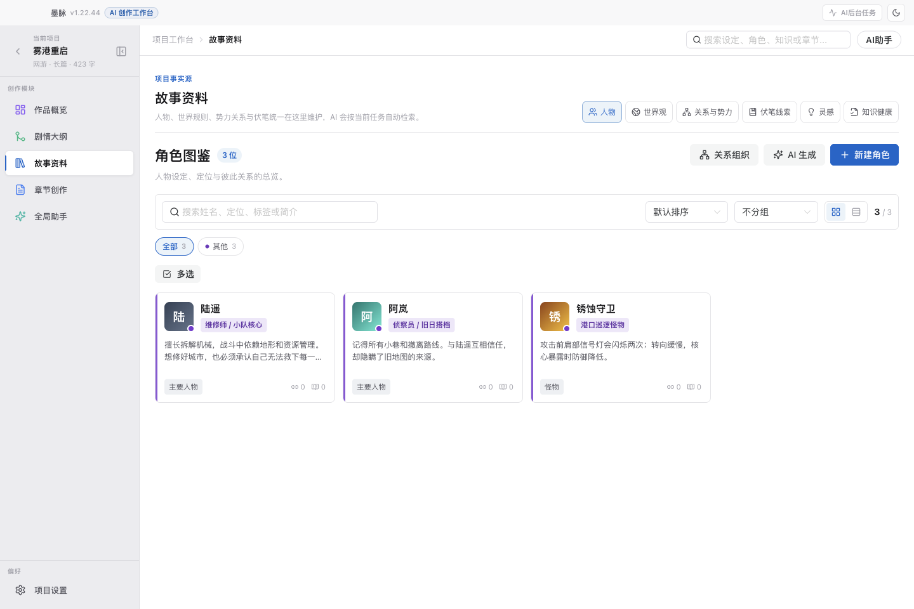</a>
      <br /><sub><b>故事资料</b> · 维护人物、世界规则与关系</sub>
    </td>
    <td width="50%" align="center">
      <a href="docs/assets/tutorial/05-chapters.png">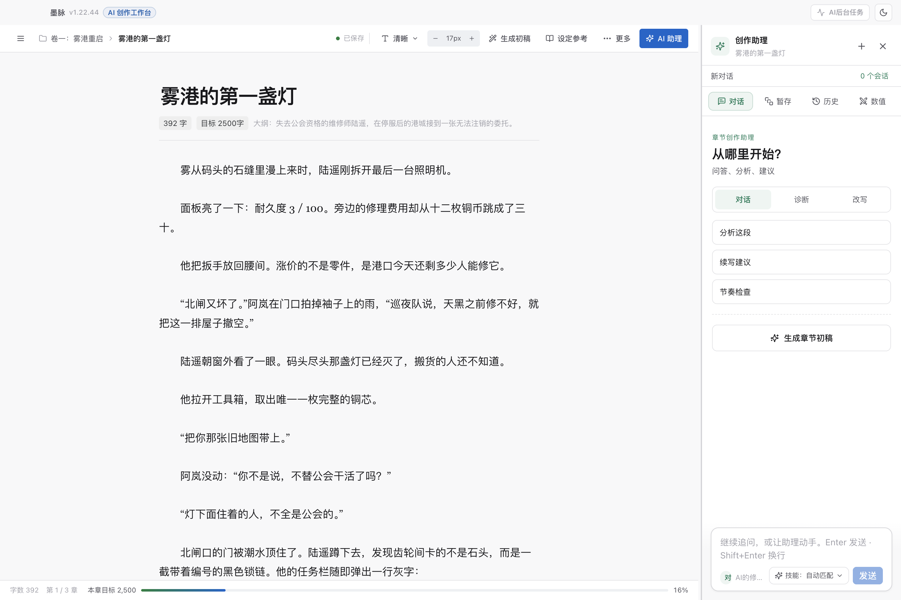</a>
      <br /><sub><b>章节创作</b> · 正文编辑与 AI 修改审阅</sub>
    </td>
  </tr>
  <tr>
    <td width="50%" align="center">
      <a href="docs/assets/tutorial/07-skills.png">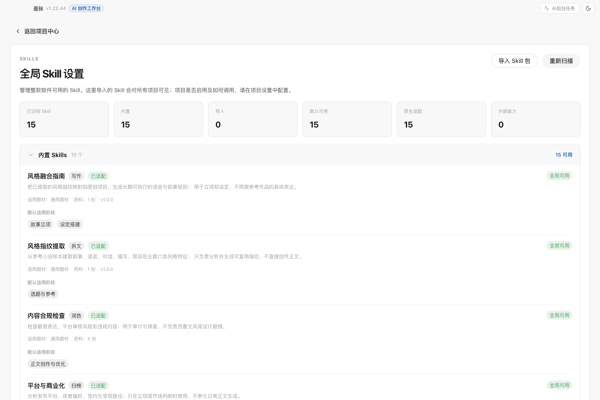</a>
      <br /><sub><b>写作 Skills</b> · 15 个内置技能与项目调用策略</sub>
    </td>
    <td width="50%" align="center">
      <a href="docs/assets/tutorial/18-game-attributes.png">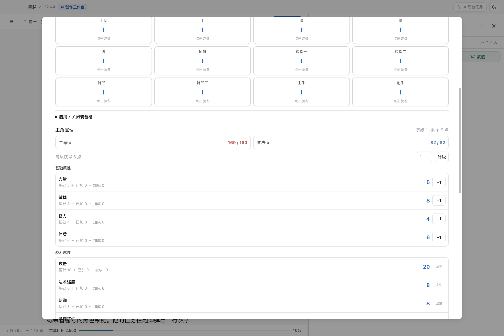</a>
      <br /><sub><b>游戏数值</b> · 管理属性、加点与章节变化</sub>
    </td>
  </tr>
  <tr>
    <td width="50%" align="center">
      <a href="docs/assets/tutorial/08-cover.png">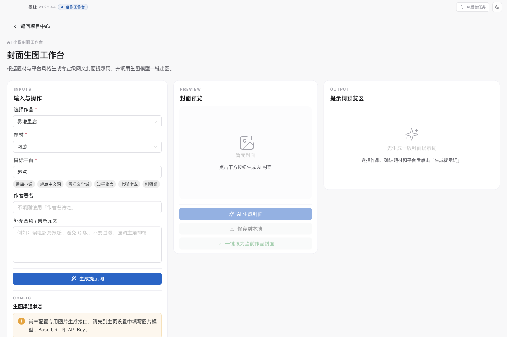</a>
      <br /><sub><b>封面工作台</b> · 生成提示词与作品封面</sub>
    </td>
    <td width="50%" align="center">
      <a href="docs/assets/tutorial/15-backup.png">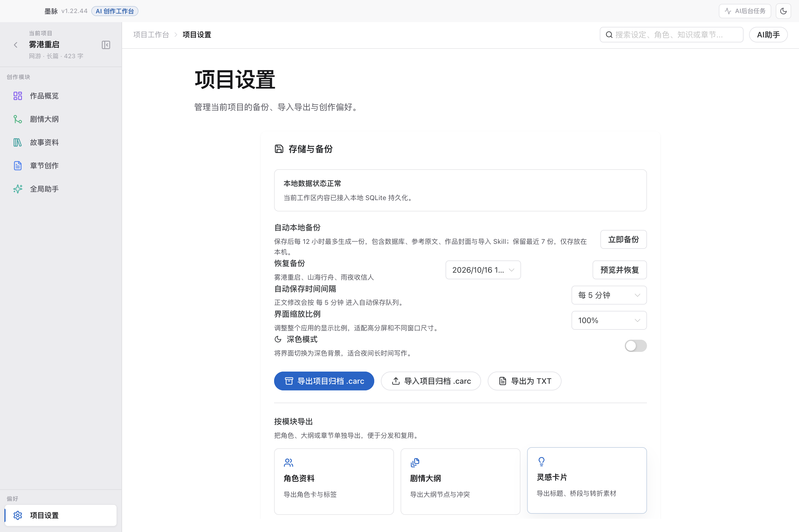</a>
      <br /><sub><b>存储与备份</b> · 项目归档与完整工作区恢复</sub>
    </td>
  </tr>
</table>

## 🧱 技术栈

| 层 | 技术 |
|---|---|
| 框架 | Electron + Vue 3 + TypeScript |
| 状态管理 | Pinia |
| UI 组件库 | Naive UI |
| 构建工具 | electron-vite (Vite 7) |
| 富文本编辑 | TipTap |
| 持久化 | SQLite（主进程） |
| 关系图谱 | Cytoscape |
| AI 接入 | Vercel AI SDK（OpenAI / Anthropic）+ 本机 Codex CLI |
| 文档解析 | mammoth (.docx)、marked (Markdown) |

## 📋 环境要求

- **Node.js**：建议使用 22.18+，兼顾 Vite 7、原生 TypeScript 测试与 `node:sqlite` 的运行要求
- **pnpm**：项目声明版本为 10.33.2
- **Windows / macOS / Linux**：建议在目标系统打包，分别生成 NSIS 安装程序、DMG 和 AppImage / DEB

## ⚡ 快速开始

```bash
# 安装依赖
pnpm install

# 启动开发环境（同时启动 Electron 主进程 + Vite 渲染进程）
pnpm run dev

# 单独检查 TypeScript / Vue 类型
pnpm run typecheck

# 类型检查 + 构建
pnpm run build

# 打包 Windows 安装程序
pnpm run dist:win

# 打包 macOS 安装包（在 macOS 上运行）
pnpm run dist:mac

# 打包 Linux 安装包（在 Linux 上运行）
pnpm run build
pnpm exec electron-builder --linux --publish never
```

安装包默认输出到 `dist/`。macOS 当前目标为 `.dmg`，使用 ad-hoc 签名且未公证；正式分发时需配置 Developer ID 签名与公证。`dist:mac` 完成后会清理展开的应用目录和辅助文件，只保留最近三个版本的 DMG。

常用验证命令：

```bash
pnpm test                        # 主要功能回归
pnpm test:skill-policy           # Skill 选择、预设与内容加载
pnpm test:reference-blueprint    # 拆书创建与参考计划
pnpm test:game-progression       # 游戏属性和章节数值账本
pnpm test:equipment-generator    # 原创装备、技能与成长位阶
pnpm test:reliability            # 备份与工作区同步
```

## 📦 自动打包与发布

仓库内置 GitHub Actions 工作流 `.github/workflows/release.yml`：

- `workflow_dispatch`：手动触发构建
- `v*` tag push：版本标签触发构建
- 相关打包配置变更的 PR：验证构建与各平台打包

工作流先构建应用，再按矩阵打包 macOS、Windows、Linux 的 `arm64` 与 `x64` 产物，上传到 Actions artifacts。当前配置分别使用 `macos-latest`、`windows-latest`，以及 Linux 的 `ubuntu-latest` / `ubuntu-24.04-arm` runner。

标签推送或手动运行在打包成功后创建 GitHub Release；手动运行会根据 `package.json` 版本复用或创建标签。PR 验证不创建 Release。实际流程见 [.github/workflows/release.yml](./.github/workflows/release.yml)。

### 🔑 配置 AI

首次进入应用后，在「设置」面板中填写：

<table>
  <tr>
    <td width="50%" valign="top">
      <b>📝 文本生成</b>
      <ul>
        <li>支持维护多套接口配置，并在标题栏快速切换</li>
        <li>Codex CLI：复用本机登录状态，无需 API Key；支持自动查找路径、拉取模型和设置推理强度</li>
        <li>协议类型：OpenAI 兼容协议 / Anthropic 协议</li>
        <li>Base URL（只需填域名或路径前缀，系统自动补全 /v1）</li>
        <li>API Key</li>
        <li>模型名称（支持从接口自动拉取）</li>
        <li>OpenAI 兼容中转默认使用 Chat Completions；官方 OpenAI 使用 Responses API</li>
        <li>思考内容是否可见取决于模型和中转站是否透传 reasoning 字段；正文落盘前会清理常见思考标记</li>
      </ul>
    </td>
    <td width="50%" valign="top">
      <b>🖼️ 图像生成</b>（封面工作台使用）
      <ul>
        <li>图像模型、API Key、Base URL</li>
      </ul>
    </td>
  </tr>
</table>

## 📁 项目结构

<details>
<summary>点击展开完整目录树</summary>

```
mo-mai/
├── electron/
│   ├── main/
│   │   ├── ai/                    # AI 管线
│   │   │   ├── agent/             # Agent Loop、系统提示词、工具注册表
│   │   │   ├── prompts/           # 通用提示词片段
│   │   │   ├── runtime/           # 任务调度、上下文构建
│   │   │   ├── runtime-v2/        # Assistant Runtime v2、暂存变更与上下文路由
│   │   │   ├── skills/            # Skill 加载与匹配
│   │   │   ├── tasks/             # 各 AI 任务 handler
│   │   │   └── transport/         # 模型传输层（OpenAI 兼容 / Anthropic / 图像）
│   │   ├── index.ts               # 主进程入口
│   │   ├── register-main-ipc.ts   # IPC 注册
│   │   ├── window-manager.ts      # 窗口管理
│   │   ├── workspace-store.ts     # SQLite 建表、迁移、快照读写
│   │   ├── workspace-backups.ts   # 完整工作区备份与恢复
│   │   └── game-progression-store.ts # 游戏目录、人物数值与章节记录
│   ├── preload/                   # window.characterArc 桥接层
│   └── shared/                    # 主进程/渲染层共享类型
├── renderer/
│   └── src/
│       ├── components/            # 业务组件
│       │   ├── chapterWorkspace/  # 章节创作工作区
│       │   └── home/              # 首页/项目中心
│       ├── features/              # 功能模块（ai、chapters、cover、knowledge、relations...）
│       ├── pages/                 # 页面级视图
│       ├── stores/                # Pinia Store
│       ├── styles/                # 全局样式
│       ├── theme/                 # 主题与设计令牌
│       ├── types/                 # 共享类型
│       └── utils/                 # 工具函数
├── resources/
│   ├── icon.ico / icon.png        # 应用图标
│   └── skills/                    # 内置 Skill 包
├── electron.vite.config.ts
├── package.json
└── tsconfig.json
```

</details>

## 🏛️ 架构概览

```
┌─────────────────────────────────────────────────────────┐
│                    Electron 主进程                        │
│  ┌──────────┐  ┌──────────┐  ┌──────────────────────┐  │
│  │ 窗口管理  │  │  SQLite  │  │     AI 管线          │  │
│  │          │  │ 读写/迁移 │  │ 调度 → Skill → 模型  │  │
│  └──────────┘  └──────────┘  └──────────────────────┘  │
├─────────────────── IPC 桥接 ────────────────────────────┤
│                    Vue 渲染层                            │
│  ┌──────────┐  ┌──────────┐  ┌──────────────────────┐  │
│  │  Pinia   │  │  TipTap  │  │    Naive UI 组件     │  │
│  │  Store   │  │  编辑器  │  │                      │  │
│  └──────────┘  └──────────┘  └──────────────────────┘  │
└─────────────────────────────────────────────────────────┘
```

> **数据流**：启动 → 主进程建窗 → 渲染层初始化 Store → 从 SQLite 加载工作区 → 用户编辑 → Pinia 更新 → 防抖写回 SQLite → AI 请求统一由主进程调用

## 🧰 内置 Skill 包

应用当前在 `resources/skills/` 下内置 15 个 Skill。技能面板会显示中文名称、功能说明、适用阶段和适用题材；不限题材的 Skill 统一标记为“通用题材”。开发版与打包版使用同一套目录结构。

| 来源 | 数量 | 代表 Skill | 说明 |
|---|---:|---|---|
| `community-skills` | 2 | `style-fingerprint`、`style-fusion` | 提取参考作品的风格特征，并转化为原创项目可执行的风格指南 |
| `Distilled-Novel-Toolbox` | 10 | `novel-pacing`、`novel-worldbuilding`、`novel-character-design` | 覆盖题材、人设、世界观、节奏、情绪、爽点、语言、平台和合规 |
| 独立写作 Skill | 3 | 仙侠升级流架构、人物驱动自然文风、网游数值战斗写作 | 按题材与创作任务补充正文方法 |

### `community-skills`

- `style-fingerprint`（风格指纹提取）：分析参考文本，不直接创作正文
- `style-fusion`（风格融合指南）：把风格指纹映射为原创项目规则

### `Distilled-Novel-Toolbox`

- `novel-character-design`（人物与群像设计）
- `novel-commercialization`（平台与商业化）
- `novel-compliance`（内容合规检查）
- `novel-emotion`（情绪与代入感）
- `novel-genres`（题材与类型融合）
- `novel-innovation`（网文创意孵化）
- `novel-language-style`（语言与文风）
- `novel-pacing`（章节节奏与结构）
- `novel-pleasure-points`（爽点设计）
- `novel-worldbuilding`（世界观与设定）

### 独立写作 Skill

- `我吃西红柿架构`（仙侠升级流架构）：用于仙侠与升级流的章节规划、力量逻辑和因果推进
- `我吃西红柿笔锋`（人物驱动自然文风）：用于正文可读性、人物行动、对白与自然表达
- `game-combat-writing`（网游数值战斗写作）：用于人物与怪物战斗的数值依据、资源变化与叙事节奏；网游题材的默认“正文创作”预设会加入此项

可使用正文创作、正文润色、大纲设计、设定建设、审计检查五类快捷组合，也可在项目中自定义绑定。已有自定义组合继续遵循作者配置。

> `resources/skills/<skill-id>/SKILL.md` 和 `resources/skills/<来源>/<skill-id>/SKILL.md` 均会自动扫描为内置 Skill。
>
> 还可以在全局 Skill 设置中导入独立 Skill 包，再由每个项目决定是否启用、适用阶段和默认预设。导入时会跳过同内容副本；同 ID 但内容更新时使用可回滚的安全替换。AI 只加载与当前任务相关的 Skill 章节，并在对话预览与回执中说明选中、跳过或回退原因。

## 💾 数据存储

应用数据保存在 Electron 用户目录下：

- 📊 **数据库**：`<userData>/data/workspace.db`（SQLite）
- 📦 **项目 Skill**：`<userData>/project-skills/<project-scope>`

可在设置中的“存储与备份”立即创建备份或恢复整个工作区。恢复前会自动保存当前状态；旧版仅数据库备份可恢复数据库，但不包含封面、参考原文和导入 Skill。

项目数据以本地文件为主。使用远程文本或图像模型时，应用会向你配置的服务发送提示词及任务所需资料；Codex CLI 模式同样通过本机 CLI 连接其服务。请根据作品资料的使用要求选择模型服务与输入范围。

## 🙏 鸣谢

- [oh-story-claudecode](https://github.com/worldwonderer/oh-story-claudecode) — 提供了核心写作 Skills 的方法论与 prompt 工程基础
- [dama-cyber/Distilled-Novel-Toolbox](https://github.com/dama-cyber/Distilled-Novel-Toolbox) — 提供了小说工作流与创作辅助方向的参考
