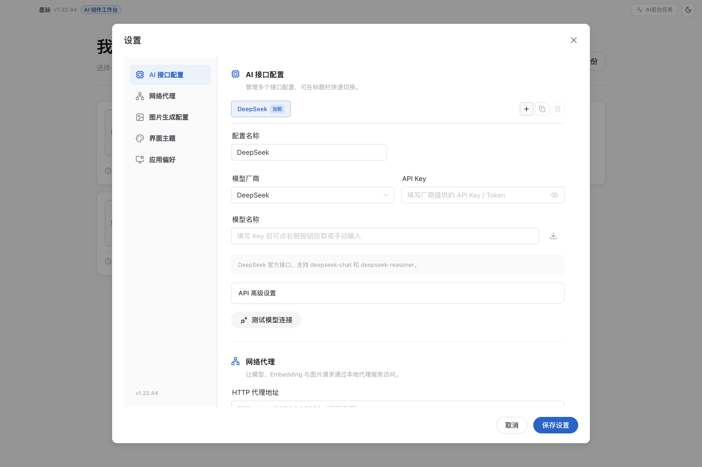
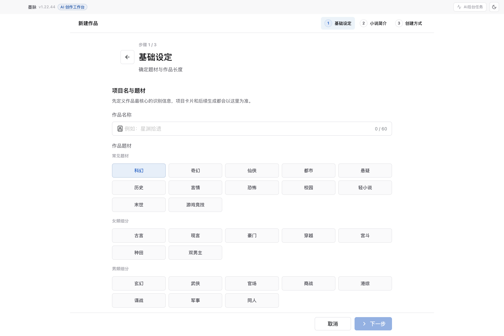
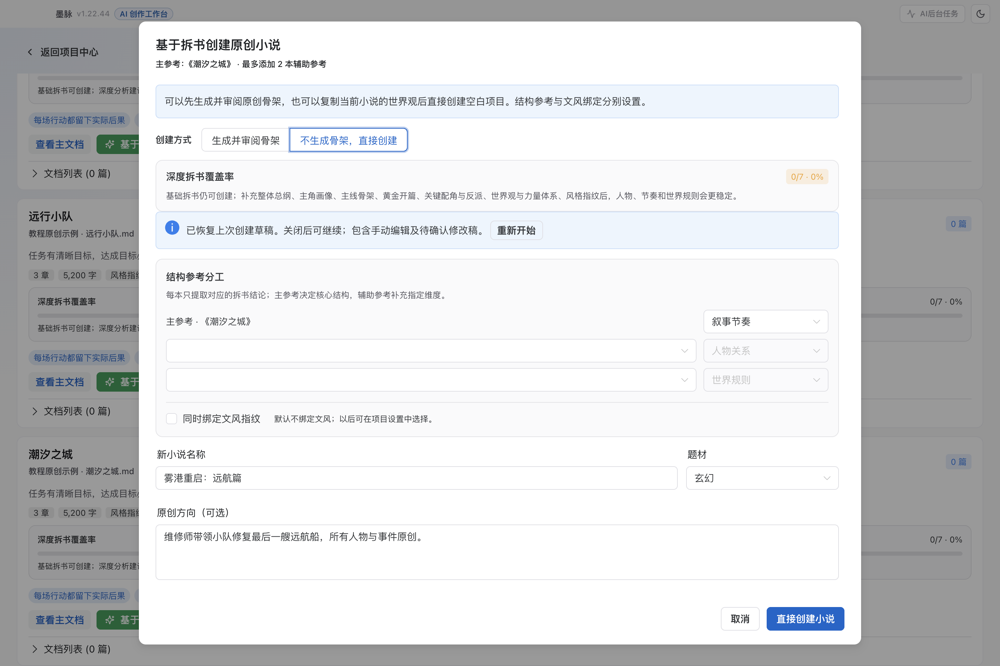
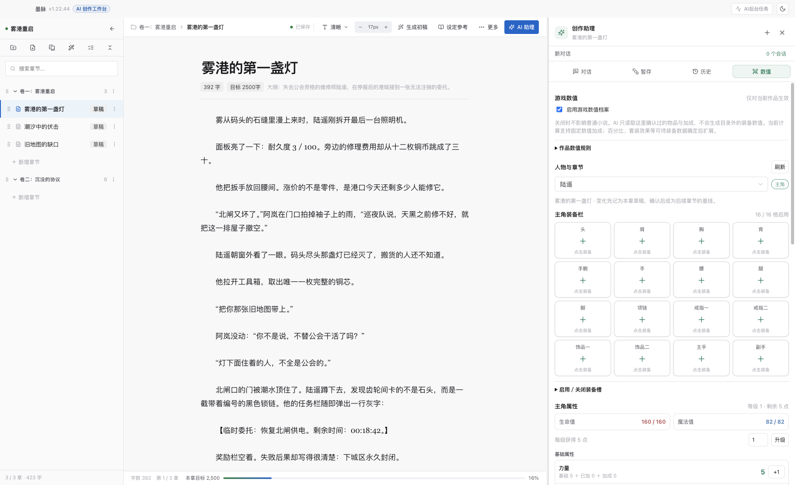
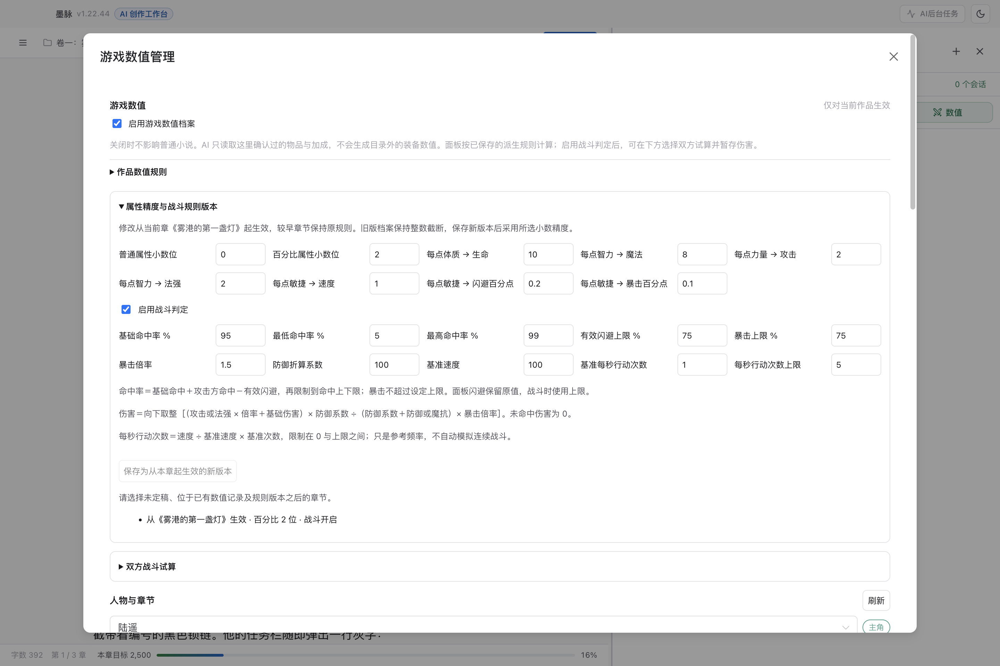
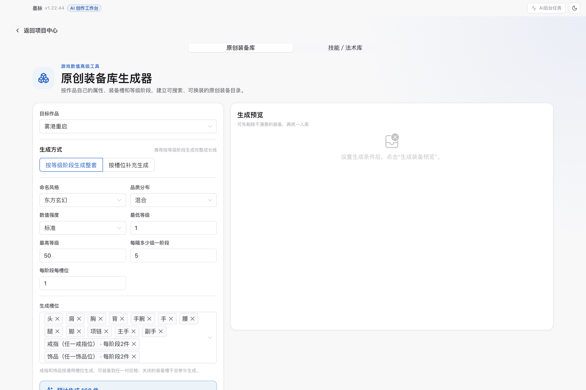
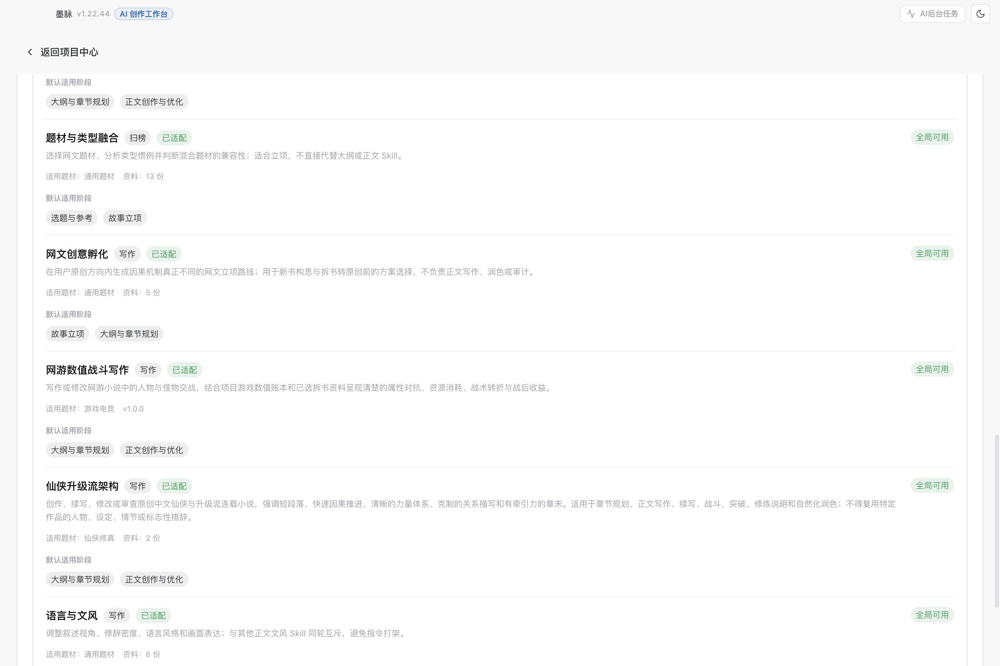
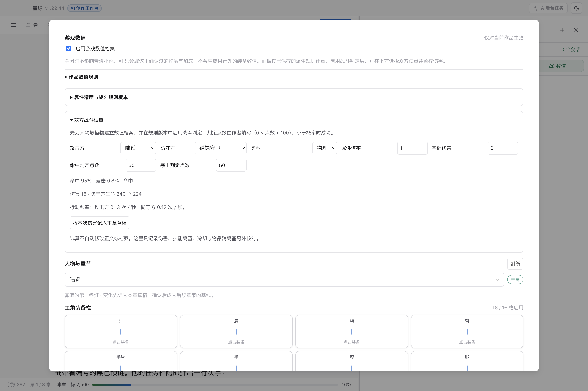

# 墨脉使用教程 · 图文版

**适用版本：v1.22.44 · 更新日期：2026-10-16**

从第一部作品开始，逐步完成设定、大纲、正文和备份。本文使用当前代码构建的桌面应用截图；《雾港重启》等作品、人物、正文与拆书条目均为教程原创演示数据。拆书分析为预置示例，用来展示界面，不代表实际模型的分析结果。

[返回项目首页](../README.md)

## 目录

1. [认识首页与创作流程](#start)
2. [配置 AI](#ai)
3. [创建第一部作品](#create)
4. [拆书参考与原创立项](#reference)
5. [维护人物和世界观](#story)
6. [组织大纲与移动分卷](#outline)
7. [章节创作与 AI 修改](#writing)
8. [选择写作 Skills](#skills)
9. [游戏数值与战斗写作](#game)
10. [制作作品封面](#cover)
11. [导出、备份与恢复](#backup)
12. [常见问题](#faq)

## 1. 认识首页与创作流程

首页的三个主要操作：

- **新建作品**：从创意开始建立项目。
- **小说续写**：把已有正文导入续写流程。
- **导入项目备份**：恢复或迁入导出的项目归档。

右上角的扳手按钮是 **高级工具**，可打开拆书知识库、写作 Skills、封面工作台、装备与技能库及网文风向标；齿轮按钮打开全局设置。

推荐第一次使用时按这个顺序：

**配置 AI → 创建作品 → 故事资料 → 剧情大纲 → 章节创作 → 审阅修改 → 导出与备份。**

手动创建和编辑可以离线进行。生成、分析、改写等 AI 功能需要可用的模型配置；调用远程模型时会发送本次任务所需的提示词与相关资料。

## 2. 配置 AI

**入口：首页 → 齿轮“设置” → AI 接口配置。**

1. 点击配置区右上角的 **新建配置（＋）**。
2. 选择模型厂商，给配置起一个容易识别的名称。
3. 填写该服务提供的 **API Key** 和 **模型名称**。支持的服务可通过模型名称右侧按钮获取列表。
4. 使用中转或自定义服务时，展开 **API 高级设置**，核对 Base URL 与接口协议。
5. 点击 **测试模型连接**，成功后点击 **保存设置**。

可以保存多个配置，在应用标题栏切换当前使用的模型。文本模型和封面图片模型分开配置；文本连接成功不代表图片服务已可用。

**使用 Codex CLI 模式：** 在模型厂商中选择对应模式，并确保本机 CLI 已安装且可正常运行。若应用提示找不到 CLI，在设置中填写可执行文件的完整路径，再测试连接。CLI 路径应指向程序文件，不能填安装目录。

**使用本地代理：** 在“网络代理”填写 HTTP 或 Mixed 端口，例如 `http://127.0.0.1:7890`，先测试代理连接。留空表示直连。

## 3. 创建第一部作品

**入口：首页 → 新建作品。**

创建向导分三步：

1. **基础设定**：输入作品名，选择题材与长篇／短篇。
2. **小说简介**：交代主角、目标、阻力和独特设定。想法不完整时，可以使用 **AI 对话构思**，讨论后将简介回填。
3. **创建方式**：选择初始化时需要 AI 参与到什么程度。

| 创建方式 | 适合情况 | 初始内容 |
|---|---|---|
| 深度生成 | 希望 AI 协助完整立项 | 推导角色、章节大纲和世界设定 |
| 快速生成 | 已有方向，需要先搭框架 | 世界观和大纲骨架，不含角色设计 |
| 空白项目 | 准备自己填写或尚未配置 AI | 基础项目结构与首章草稿 |

示例简介：

> 游戏停服后，维修师陆遥仍留在雾港。他与旧友用有限资源守住最后的避难所，追查一份把居民当成耗材的撤离协议。第一卷以修复北闸为目标，逐步揭露城市的能源困境。

创建后先看 **作品概览**，检查简介和生成的设定是否符合方向，再进入故事资料和大纲逐项调整。

## 4. 拆书参考与原创立项

### 4.1 导入参考作品

**入口：首页 → 高级工具 → 拆书知识库。**

1. 点击 **导入小说并拆书**，选择本地文本文件；支持 TXT、Markdown、DOCX。
2. 完成基础拆解后，参考作品卡片中会出现分析信息。
3. 需要更完整的结构结论时，点击 **AI 深度拆书**，查看七个维度的覆盖情况。
4. 要借鉴语言表达方式时，单独执行 **风格指纹提取**。

基础拆书完成后即可进入创建流程；深度分析不足时，界面会提示建议补齐的维度。教程截图中的覆盖率为 0，是尚未执行深度分析的演示状态。

### 4.2 给多本参考明确分工

在主参考的卡片上点击 **基于拆书创建小说**。

- **主参考 1 本**：确定最主要的借鉴方向，例如叙事节奏。
- **辅助参考最多 2 本**：每本指定用途，例如人物关系或世界规则。
- **同时绑定文风指纹**：默认不勾选。需要文风参考时再打开，并单独选择文风来源。

示例分工：

| 参考位置 | 本次用途 | 给 AI 的约束 |
|---|---|---|
| 主参考 | 叙事节奏 | 学习目标、阻力、转折的组织方式 |
| 辅助 1 | 人物关系 | 学习队友分歧和信任建立 |
| 辅助 2 | 世界规则 | 学习资源限制如何影响选择 |

在 **原创方向** 中写清楚自己的主角、目标和世界差异。系统按用途提取拆书结论，不把几本全文混合成创作上下文。

### 4.3 生成、审阅和修改骨架

选择 **生成并审阅骨架** 后：

1. 填写名称、题材、原创方向和分卷方式。
2. 点击 **生成 4 条创意思路**，检查不能改动的事实，再选择一条故事路线。
3. 继续生成骨架，检查世界规则、每卷阶段目标、剧情节点和章节建议。
4. 局部不满意时，使用 **手动编辑骨架**，修改后点击 **保存修改**。
5. 也可在 **和 AI 对话修改骨架** 中输入要求，查看待确认修改稿，点击 **采用修改稿** 或 **放弃这次修改**。
6. 审阅完成后，点击 **确认骨架并创建项目**。

可直接使用的修改要求：

> 第二卷的目标改为主角主动夺回北闸，不要提前揭晓幕后人。只修改这一卷的目标、相关节点和章节建议，保留其他卷。

骨架预览和修改稿都处于创建前阶段；最终确认后才生成新项目。参考分工、表单、创意路线、骨架和未采纳修改会自动保存在本机。关闭后，从同一作品和主参考重新打开会恢复草稿；“重新开始”会先要求确认。

### 4.4 不生成骨架，直接创建

1. 先打开作为世界观来源的作品，再进入拆书知识库。
2. 在创建弹窗选择 **不生成骨架，直接创建**。
3. 填写新作品名、题材与篇幅，按需勾选 **复制当前小说《……》的世界观**。
4. 核对界面显示的来源作品名和条目数量后，执行创建。

这条路径不调用骨架生成。它复制世界观文字并分配新条目 ID，创建空白起始卷和首章占位；人物、组织、关系、大纲和正文不会一起复制。来源作品没有世界观时，复制选项不可用。

## 5. 维护人物和世界观

**入口：打开作品 → 故事资料。**

从顶部页签切换 **人物、世界观、关系与势力、伏笔线索、灵感、知识健康**。

建议先建立能够支撑第一卷的最小资料集：

- **人物**：姓名、定位、当前目标、行为习惯，以及不能轻易跨过的底线。
- **世界观**：地点、力量规则、资源来源和行动代价。
- **关系与势力**：谁帮助谁，谁控制资源，谁隐瞒事实。
- **伏笔线索**：何时埋下、希望何时回收、回收后改变什么。

人物卡会作为 AI 检索的资料来源。点击助手的 **检查全部人物**，或明确要求“检查全部人物卡”，程序会分批读取完整内容（长卡自动续读），逐批调用 AI 审查后汇总，可随时停止。批次数多时耗时与模型用量也会增加。回复下方的 **本次参考资料** 区分全文、摘要、部分内容和尚未读取；它记录工具实际返回范围，不代表模型理解或结论一定正确。

## 6. 组织大纲与移动分卷

**入口：打开作品 → 剧情大纲。**

先 **新增分卷**，填写卷名和阶段目标，再 **新增节点**。一个节点至少写清标题、核心冲突和剧情摘要；状态可标记为点子、已规划、写作中、已完成。

### 单独移动

打开节点的操作菜单，选择 **移动到分卷**，指定目标卷后确认。需要先有至少两个分卷。

### 批量移动或删除

1. 点击 **选择模式**。
2. 点击需要操作的节点，底部会显示选中数量。
3. 点击 **移动到分卷**，选择目标卷并确认；节点按原有顺序追加到目标卷末尾。
4. 要删除时，点击选中工具栏的 **删除**，核对数量后确认。

**操作范围：** 移动前会显示节点及关联章节数量。默认勾选 **同时移动关联章节**，也可取消以仅移动大纲。完成后可点击 **撤销分卷移动** 恢复上一次位置，期间编辑的正文会保留；目录结构发生其他变化后不能安全撤销。删除大纲仍保留已有章节正文。

已关联章节的节点可点击 **打开章节**；尚未关联的节点可点击 **创建章节**。

## 7. 章节创作与 AI 修改

**入口：章节创作，或大纲节点上的“打开章节”。**

编辑区维护正文；顶部可查看保存状态、调整阅读字号、打开 **设定参考**，或点击 **生成初稿**。AI 助理位于右侧，可切换对话、暂存、历史和数值。拖动分隔线可调整宽度；数值页的 **展开数值管理** 可打开宽面板。

### 从大纲生成初稿

1. 确认章节已关联正确的大纲节点，摘要和目标字数合理。
2. 点击 **生成初稿**，检查所选资料和写作技能。
3. 生成后阅读正文，核对人物动机、事件顺序、设定和章末悬念。

### 通过对话修改

可以选中一段文字后提出局部要求，也可以说明整章修改范围。例如：

> 把陆遥和阿岚的争执压缩到三轮对白，保留“灯下面住着的人，不全是公会的”这句。通过动作表现犹豫，不新增人物和设定。

AI 的修改会进入 **暂存** 区。先检查修改对象和差异，再逐条确认；需要追溯时查看 **历史**。提出修改要求不等于已经采用修改。

跨人物、世界观、大纲的工作，可以使用工作台的 **全局助手**。先让它核对资料，再审阅它暂存的变更。

## 8. 选择写作 Skills

**全局入口：首页 → 高级工具 → 写作 Skills。**

全局页面负责查看和导入可用 Skill；单个作品的启用状态与预设在 **项目设置** 中配置。当前内置 15 个技能，涵盖创意、世界观、人物、大纲节奏、正文文风、网游战斗等任务。

对话输入区的 **技能** 菜单决定本轮如何使用：

| 策略 | 适合情况 |
|---|---|
| 自动匹配 | 让助手按任务选择已启用的相关技能 |
| 仅使用指定 Skill | 明确限制本轮使用范围 |
| 不使用 Skill | 本轮按直接指令处理 |

“当前执行策略不允许使用 skill”通常说明本轮选择范围与请求不一致。检查输入区的技能策略，并确认该技能在项目中启用，再重新提交。

## 9. 游戏数值与战斗写作

普通小说可跳过本节。游戏题材建议先确定规则，再让 AI 写带精确数字的战斗。

### 9.1 建立人物档案

**入口：章节编辑器 → AI 助理 → 数值。**

1. 勾选 **启用游戏数值档案**。
2. 选择已有的人物卡，点击 **为此人物建立数值档案**。
3. 按需点击 **设为主角**。
4. 展开 **初始数值（作者设定）**，填写初始等级、可用点数与各项基础值并保存。
5. 为需要精确跟踪的怪物也建立人物卡和数值档案。

### 9.2 设置增长规则

在 **作品数值规则** 中设置升级点数、成长位阶。派生系数、小数精度和战斗公式在 **属性精度与战斗规则版本** 中设置，保存为从当前章起生效的新版本。请选择未定稿且没有本章及后续数值记录的章节；已有版本之后才能新增版本。

默认每升一级获得 **5 个可分配点数**。默认派生关系如下：

| 基础属性增加 1 点 | 派生变化 |
|---|---|
| 力量 | 攻击 +2 |
| 敏捷 | 速度 +1、闪避 +0.2 个百分点、暴击 +0.1 个百分点 |
| 智力 | 魔法上限 +8、法术强度 +2 |
| 体质 | 生命上限 +10 |

防御、魔法抗性、命中和幸运没有默认的基础属性换算系数；其数值来自对应基础设定和有效加成。启用战斗判定后，速度可按“速度 ÷ 基准速度 × 基准次数”换算每秒行动频率，并限制到所设上限；不自动模拟连续战斗。

新档案默认普通属性保留 0 位小数、百分比属性保留 2 位小数，因此敏捷 +1 的 0.2 个百分点闪避不会被丢弃。旧档案保持原来的整数截断，保存新规则版本后才采用所选精度。较早章节使用旧规则；人物初始档案已有事件后仍锁定。每级点数的后续调整用于以后的升级。章节重排会按新的顺序重算数值，规则生效位置随对应章节移动。

### 9.3 准备装备与技能

**入口：首页 → 高级工具 → 装备与技能库。**

1. 选择目标作品。
2. 在 **原创装备库** 或 **技能／法术库** 中设置风格、等级范围和生成条件。
3. 生成预览，剔除不需要的条目，再加入作品目录。
4. 回到“数值”面板，将物品加入背包、装备到槽位，或将技能设为已学。

目录中有某个技能，不等于人物已经学会；战斗前应核对人物自己的已学技能与资源。

### 9.4 用数值推动战斗

启用 **网游数值战斗写作**，指定本章人物、怪物和参考拆书。例如：

> 先读取陆遥与锈蚀守卫的本章数值状态，再写北闸战斗。参考指定拆书中的“试探—反馈—转折”节奏，突出剩余资源如何影响选择。只使用已登记装备与技能；没有确认的伤害公式不要编造扣血结果。需要记账的变化先暂存给我审阅。

写完后，在数值面板检查本章人物变化，确认升级、加点、受伤、恢复、消耗和换装是否与正文一致，再确认本章记录。

**双方战斗试算：** 先在规则版本里启用战斗判定，设置命中上下限、闪避上限、暴击上限、减伤系数与行动频率。再选双方、伤害类型、倍率和判定点数（0 ≤ 点数 < 100）；点数小于概率才成功。预览确认后点击 **将本次伤害记入本章草稿**。后端重新计算伤害，技能耗蓝、冷却与物品消耗需另行记录。默认规则关闭，未启用时 AI 不得自行发明公式或判定结果。

## 10. 制作作品封面

**入口：首页 → 高级工具 → 封面工作台。**

1. 选择作品，确认题材、目标平台和作者署名。
2. 写下画风要求与禁忌元素，例如“港城夜色、单人背影、避免 Q 版”。
3. 点击 **生成提示词**，审阅提示词内容。
4. 确认专用图片服务或 Codex CLI 模式已配置，再点击 **AI 生成封面**。
5. 满意后 **保存到本地** 或 **一键设为当前作品封面**。

本次生成记录用于当前会话内对比。需要长期保留的图片应保存到本地或设为作品封面。截图展示未配置图片服务的初始状态。

## 11. 导出、备份与恢复

**入口：打开作品 → 项目设置 → 存储与备份。**

| 操作 | 用途 |
|---|---|
| 导出为 TXT | 获取正文文本，用于阅读、投稿或继续编辑 |
| 导出项目归档 `.carc` | 保存单部作品，便于迁移与重新导入 |
| 按模块导出 | 单独导出人物、大纲、灵感、关系或章节数据 |
| 立即备份 | 保存整个工作区，包括数据库、参考原文、封面和导入 Skill |
| 预览并恢复 | 按选定备份恢复整个工作区 |

恢复前，先核对时间和作品列表。恢复会影响所有作品与设置，并重启应用；系统会先保存恢复前状态。旧版“仅数据库”备份不包含封面、参考原文与导入 Skill。

自动备份和手动备份保存在本机。跨设备迁移作品时，导出 `.carc` 并在目标设备通过首页“导入项目备份”打开。

## 12. 常见问题

### 只想借剧情结构，不想学参考作品的文风？

在拆书创建中保留 **同时绑定文风指纹** 为未勾选。每本参考分别指定结构用途。

### 骨架大部分满意，只想修改两处？

在创建前点击 **手动编辑骨架**，或者通过 **和 AI 对话修改骨架** 提出具体要求，审阅修改稿后采用。

### 可以沿用当前小说世界观，直接创建吗？

可以。打开来源小说后进入拆书创建，选择 **不生成骨架，直接创建**，核对复制世界观的来源和数量。

### 为什么移动大纲以后，旧章节还在原来的卷？

检查移动时是否勾选“同时移动关联章节”，以及章节是否关联该大纲节点。勾选后会一并迁移这些章节，移动前可查看数量。

### 为什么 AI 没有读完全部人物卡？

普通任务按需检索；要求“检查全部人物卡”会自动分批审查。展开回复下方“本次参考资料”，可核对完整读取数与未完整读取条目。取消或出错时不会声称已全部完成。

### 修改游戏规则为什么不可用？

派生系数和精度请保存为新规则版本，从尚无记录的后续章节生效。已产生事件的人物初始档案继续锁定；加点、升级等变化记录到章节事件中。

### 图片生成按钮不可用或生成失败？

先检查是否生成了封面提示词，再检查专用图片服务或 CLI 配置。文本模型配置不能代替图片配置；具体失败原因以应用显示的接口错误为准。

---

教程随仓库维护。截图原文件位于 [assets/tutorial](assets/tutorial)，可点击图片查看细节；文档可在 GitHub 或支持 Markdown 的编辑器中阅读。截图制作和后续更新方法见 [教程维护说明](tutorial-maintenance.md)。
